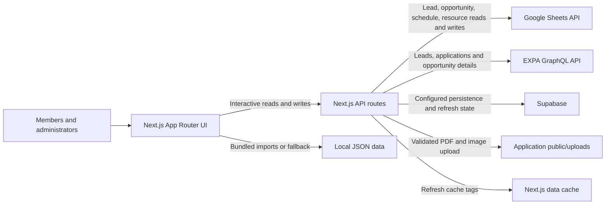

# AIESEC LC Tunis – Operations & Performance Dashboard


A web application for coordinating member outreach and reviewing marketing and operations performance at **AIESEC LC Tunis**. It brings member-facing workflows and administrator reporting into one dashboard, drawing on Google Sheets, EXPA, Supabase, and bundled data according to the feature and environment configuration.

**The problem it addresses:** outreach activity, leads, applications, schedules, opportunities, and member resources can be scattered across separate tools. This dashboard gives members a shared workspace and gives administrators a consolidated view of activity and conversion, helping the local team coordinate work and inspect its funnel.

## Application Preview

| Welcome page | Member dashboard | Admin dashboard |
|---|---|---|
|  |  |  |

The screenshots are the original repository images. The member screenshot shows the member ranking view; the admin screenshot shows analytics and navigation.

## Overview

### Member Dashboard

The member interface is designed for day-to-day outreach work. It includes:

- **Today Attraction:** physical leads and scheduled attractions, with a daily leaderboard.
- **Attraction Timeline:** upcoming and scheduled outreach activity.
- **Sales Speech:** opportunity details and guidance for conversations with prospective applicants.
- **Ranking:** member performance based on attraction activity.
- **Testimonials and Resources:** shared materials and experience from other members.

Member dashboard pages are currently public and do not require member authentication.

### Admin Dashboard

The admin interface provides analytics and management tools for local operations:

- A central dashboard with lead activity, EXPA funnel metrics, charts, refresh controls, and recent activity.
- University outreach information and opportunity management.
- Digital and physical attraction reporting and conversion rates.
- Attraction rankings and scheduled attraction management.
- Member resources, including PDF and image uploads.
- OGV and OGT opportunity submission views and workflows.

## Key Features

### Outreach and performance

- Tracks digital and in-person attraction separately.
- Groups performance by member, university, programme, referral source, and time period where the underlying data supports it.
- Calculates signup, application, approval, and realization measures from the available sheet and EXPA data.
- Provides member-facing leaderboards and a timeline for scheduled outreach.

### EXPA integration

- Server-side GraphQL clients retrieve lead, application, and opportunity information.
- Application lookup batches person IDs and selects the most advanced relevant status per person for funnel reporting.
- Refresh logic revalidates cached EXPA data and records the last successful refresh in Supabase when configured.
- A protected `POST /api/cron/expa-refresh` endpoint can trigger the refresh. A scheduler must call it; the repository does not establish a hosting schedule.

### Google Sheets integration

- Server-side Google Sheets access loads physical and digital lead data, opportunities, resources, submissions, and scheduled attractions.
- The admin ranking tools include sheet-tab and member-name column resolution because the physical data sheet has a positional layout.
- Opportunity reads fall back to bundled JSON seed data when sheet data is empty or unavailable.

### Persistence and resources

- Supabase is used for supported persistent records, including submissions, opportunities, scheduled attractions in some configurations, and EXPA refresh state.
- Admin uploads accept PDF and image formats up to 10 MB and store files under `public/uploads` on the application server.
- Resources and opportunities can also be represented by Google Sheets or bundled JSON data depending on the feature.

### Validation and abuse controls

- Zod validates several API request payloads; user-provided text is sanitized in relevant submission flows.
- Public member opportunity submissions use per-IP rate limiting and a honeypot field.
- Admin login uses a rate limiter backed by Upstash Redis when configured, with an in-memory local fallback.

## Technical Architecture

The app uses the Next.js App Router. Route components compose the interface, client components handle interactive screens, and server-side API routes access external services and protect data that is intended for admins. Data paths vary by feature: some server loaders read Sheets or EXPA, some writes use Supabase, and some views import local JSON directly or use it as a fallback.



**Typical flow:** a dashboard page requests data from an API route or server loader; the server reads from the relevant integration, normalizes and aggregates records, then returns data to the UI. Some reporting is cached and revalidated rather than fetched continuously. When a live source is missing or has no records, selected features use local seed or fallback data.

## Technology Stack

| Area | Technologies verified in the repository |
|---|---|
| Frontend | Next.js 16 App Router, React 19, TypeScript 5, Tailwind CSS 4, ApexCharts, FullCalendar, Framer Motion |
| Backend | Next.js Route Handlers, Node.js APIs for file uploads, Zod validation |
| Database and storage | Supabase JS client; local JSON seed/fallback files; server filesystem for uploaded files |
| External integrations | Google Sheets API via `googleapis`; EXPA GraphQL API |
| Authentication and security | `jose` signed JWT sessions, `bcryptjs`, Upstash Redis rate limiting with in-memory fallback |
| Testing and tooling | Vitest, ESLint, TypeScript, npm |
| Automation | Protected HTTP cron endpoints for EXPA refresh and attraction cleanup; external scheduling is not defined in this repository |

## Security and Access Model

- Admin credentials are read from environment variables. The configured password is verified against a bcrypt hash.
- Successful admin login creates a signed JWT session stored in an HTTP-only cookie with `sameSite: lax`, a seven-day lifetime, and `secure` enabled in production.
- Admin dashboard pages check the session, and sensitive routes such as lead reporting, rankings, admin resource management, and EXPA details call the admin role guard.
- Login attempts use Upstash Redis rate limiting when its URL and token are configured. Otherwise, the app uses an in-memory limiter, which is process-local and unsuitable for distributed production traffic.
- Member-facing pages are public and have no member sign-in or role-based member access at present.
- Public member submission routes have their own input validation and IP rate limiting; route-level protection is not uniform across every API endpoint. Review each endpoint before exposing the service publicly.

**Before publishing or deploying:** `src/lib/server/expaTokenSource.ts` currently contains an in-source fallback credential. Remove that fallback and rotate the credential before making the repository public or relying on it in production. The README intentionally does not reproduce it. The `.env.example` file is a variable-name template; never place real credentials in Git.

## Data Sources and Limitations

This project has a **hybrid data architecture**:

- Some records are fetched from Google Sheets or EXPA through server-side integrations.
- Supabase provides persistence for selected features when configured; its absence changes the behavior of those features.
- Local JSON files provide seed data and fallbacks. For example, opportunities use bundled data when Sheets returns no entries or fails.
- The application caches selected datasets and exposes an explicit EXPA refresh endpoint. It is not universally real-time, and the repository does not configure the external scheduler that would call the cron endpoint.
- The data-directory README describes mock and parsed data conventions, while the current app also has specific JSON data files and live integration code. Treat bundled records as sample/fallback data unless their provenance and refresh path are confirmed.
- Integration setup requires valid credentials, spreadsheet access, and any expected Supabase tables. Missing configuration can cause integration-backed functionality to fail or fall back, depending on the feature.

## Getting Started

### Prerequisites

- Node.js and npm. The repository includes `package-lock.json` for reproducible npm dependency installation; it does not pin a Node.js version.
- Git.
- For integration-backed features, credentials and access for the relevant Google Sheets, EXPA, Supabase, and optionally Upstash services.

### Local development

```bash
git clone <repository-url>
cd <repository-directory>
npm install
```

Create a local environment file from the template:

```bash
cp .env.example .env.local
```

Set the values required for the features you intend to run in `.env.local`. The example lists admin session and password-hash settings, Google Sheets service-account settings, EXPA, Supabase, Upstash rate limiting, cron protection, and optional spreadsheet/ranking overrides. Do not commit `.env.local` or use real production secrets in a public fork.

Start the development server:

```bash
npm run dev
```

Then open [http://localhost:3000](http://localhost:3000). The package also defines `npm run build`, `npm run start`, `npm run lint`, and `npm test` scripts. Note that the lint script is configured as `next lint`; check compatibility with the installed Next.js version if it does not run in your environment.

## Project Structure

```text
src/
├── app/                 App Router pages and API Route Handlers
│   ├── dashboard/       Admin analytics and management screens
│   ├── member-dashboard/ Member workflows
│   └── api/             Auth, data, integration, upload, and cron endpoints
├── components/          Shared UI, charts, tables, and authentication UI
├── context/             Authentication, dashboard data, theme, and sidebar state
├── data/                JSON seed data and data-related helpers
├── lib/                 Auth, integrations, data access, normalization, and utilities
│   └── server/           Server-only EXPA clients, mapping, statistics, and refresh logic
└── layout/              Shared app header, sidebar, and layout elements
public/                  Static assets and uploaded-file destination
```

Additional root files include `next.config.ts`, `package.json`, `package-lock.json`, `.env.example`, and `vitest.config.ts`.

## Future Improvements

These are potential next steps, not claims about existing functionality:

- Add member authentication and a consistent role/permission model across pages and API routes.
- Remove source-level credentials, rotate any exposed tokens, and validate the deployment secret setup.
- Standardize persistence and fallback behavior so data provenance and freshness are visible in the UI.
- Add integration-level and end-to-end tests for Sheets, Supabase, EXPA refresh, and access control.
- Add CI checks for linting, type checking, tests, and production builds.
- Add structured logging, error monitoring, and operational health checks.
- Define and document deployment infrastructure and the external schedule for protected cron jobs.
- Move uploaded files to durable object storage if deployments use ephemeral application filesystems.

## Project Context

This is an organizational operations project for **AIESEC LC Tunis**. Its focus is supporting local marketing and attraction work: giving members common tools for outreach and giving administrators a consolidated way to review activity, leads, and conversion data. The repository documents the implementation and integrations; it does not publish independently verified impact metrics or establish a specific production hosting provider.
